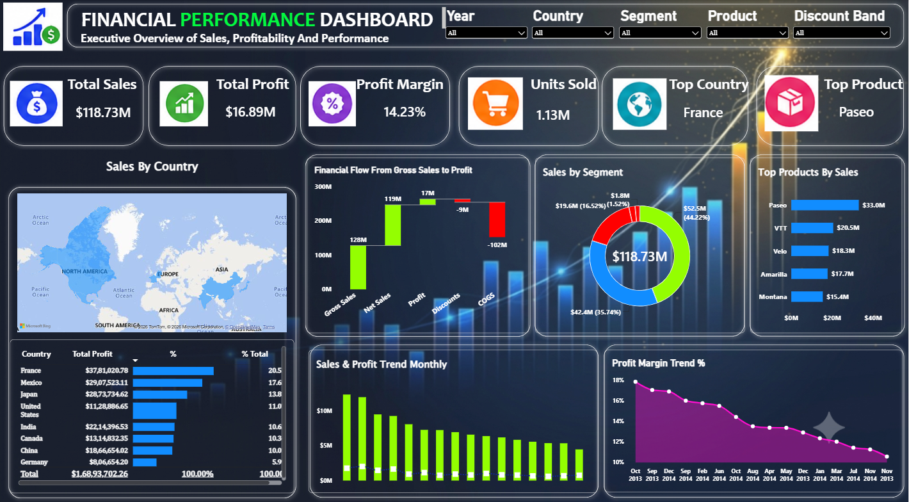

# 💰 Power BI Finance Dashboard

An executive-level Power BI dashboard that analyses **700 financial records across 8 countries, 5 customer segments and 6 products (September 2013 – December 2014)**. It follows the money from gross sales to profit and shows where the business makes or loses margin.

## 📂 Files in this repository

| File | Description |
|------|-------------|
| [`Power_Bi_Finance_Dashboard.pbix`](./Power_Bi_Finance_Dashboard.pbix) | Power BI report (data model, DAX measures and dashboard) |
| `dashboard-preview.png` | Screenshot of the dashboard |
| `README.md` | Project overview |

> GitHub cannot preview `.pbix` files. Click the file, use the **Download raw file** button and open it in **Power BI Desktop** (free for Windows) to use the slicers and cross-filtering.

## 📊 Headline numbers

| Metric | Value |
|--------|-------|
| Gross sales | 127.93 million |
| Discounts given | 9.21 million (7.2% of gross sales) |
| Net sales | **118.73 million** |
| Cost of goods sold (COGS) | 101.83 million |
| Total profit | **16.89 million** |
| Profit margin | **14.2%** |
| Units sold | **1.13 million** |

## 🔍 Key insights

1. **Government is the engine of the business.** It brings in 44% of net sales and about 67% of total profit, with a healthy 21.7% margin.
2. **Enterprise sells a lot but loses money.** It generates 19.6M in sales, yet its margin is negative (-3.1%). This is the first segment to investigate.
3. **Channel Partners have the best margin (73%)** but make up only 1.5% of sales, so there is clear room to grow this segment.
4. **Discounts eat into profit.** Orders with no discount earn a 21.9% margin and the Low band 17.9%, but the High discount band drops to just 9.1%.
5. **France is the top country** with 24.4M in sales (20.5%), followed by Mexico (20.9M) and Japan (16.4M). Germany is the smallest at 7.1M.
6. **The United States has the weakest margin (8.6%)** among all countries, while India (17.6%) and Japan (17.5%) are the strongest.
7. **Paseo is the top product** with 33.0M in sales (27.8% of total). Amarilla has the best margin at 15.9%.
8. **Peak month:** October 2014 had the highest sales (12.4M). Note that 2013 only covers September to December, so the year-on-year comparison is not like for like.
9. **58 transactions are loss-making,** which is worth a deeper look in the data.

## 🛠️ Tools & techniques used

- Power BI Desktop
- DAX measures: Total Sales, Total Profit, Profit Margin %, Top Country, Top Product, Financial Flow Value (waterfall)
- Calendar (date) table for monthly trends
- Interactive visuals and slicers

## 📄 Dashboard visuals

- KPI cards: Total Sales, Total Profit, Profit Margin, Units Sold, Top Country, Top Product
- Waterfall: Financial Flow from Gross Sales to Profit
- Combo chart: Sales and Profit trend (monthly)
- Area chart: Profit Margin trend %
- Filled map: Sales by Country
- Donut: Sales by Segment
- Bar chart: Top Products by Sales
- Slicers: Year, Country, Segment, Product, Discount Band

## 👤 Author

**Sunny Pawar** — [GitHub](https://github.com/sunnypawarr)
